# Ćwiczenia 28 -- instalacja i konfiguracja usługi DHCP

1. Zaloguj się na serwerze na konto administrator.
1. Sprawdź czy dolna karta sieciowa ma następującą konfigurację:

   - ip: 10.9.8.1/27
   - brak bramki,
   - 1 DNS 10.9.8.1

1. Sprawdź na stacji ustawienia kart sieciowych w wierszu poleceń:

   ```bash
    ipconfig /all 
    route print
   ```

1. Sprawdź czy rola DHCP jest zainstalowana np. w Menedżerze Serwera.

1. Zatrzymaj usługę DHCP, a następnie ją uruchom.

   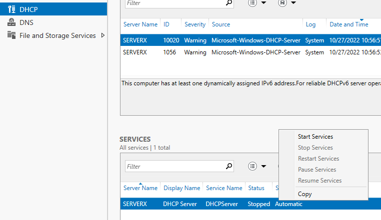

1. Otwórz przystawkę DHCP z narzędzi (tools).

1. Usuń istniejący zakres, a następnie utwórz nowy o nazwie twoje imię.

   **Nie dodawaj wykluczeń ani zastrzeżeń, ani serwera WINS.**

   Dodaj dwa adresy DNS.

   Czas dzierżawy 8 dni.

   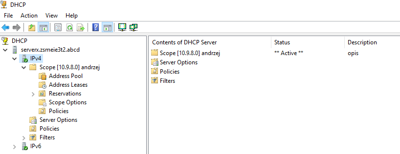

1. Prawy klawisz myszy na zakresie i właściwości:

   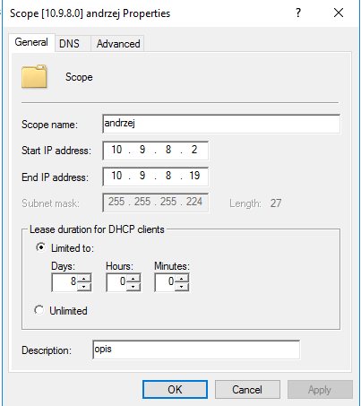

1. Zaloguj się na stacji roboczej i ustaw **dla dolnej** karty
    pobieranie ustawień z serwera DHCP.

1. Sprawdź na stacji czy zostały pobrane ustawienia graficznie(prawy
    klawisz myszy na połączeniu sieciowym, wybieramy stan-\> szczegóły).

   W wierszu poleceń:

   ```bash
   ipconfig /all.
   ```

   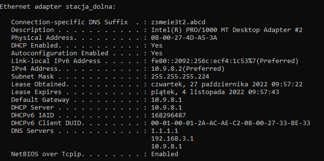

   Sprawdź poprawność:
   - ip
   - maski
   - czasu dzierżawy ( domyślny to 8 dni )
   - bramki
   - nazwy domeny
   - serwera DHCP
   - dwóch serwerów DNS

   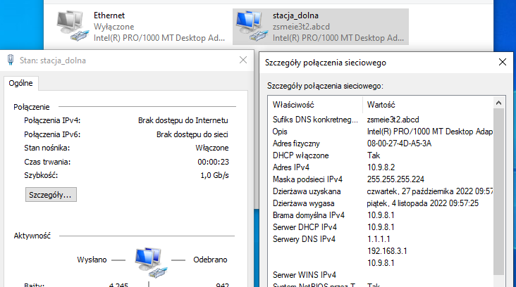

1. Sprawdź na serwerze dzierżawy adresów:

   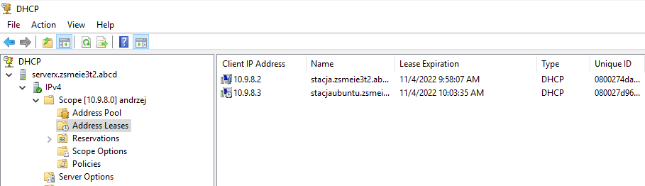

1. Uruchom przystawkę DHCP z narzędzi administracyjnych i wprowadź w
    ustawieniach zastrzeżenie dla stacji roboczej ( **podaj opis: twoje imię, mac i adres IP**).

   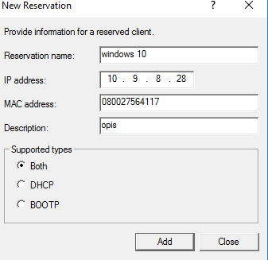

   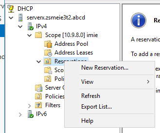

1. Sprawdź na stacji czy zostały pobrane ustawienia.

   Należy wyłączyć kartę, a następnie ją włączyć.

   Jeśli nie to wyłącz kartę, a następnie włącz ponownie.

   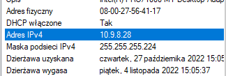

1. Na serwerze ustaw czas dzierżawy na 1 dzień 4 godziny i 35 minut.

   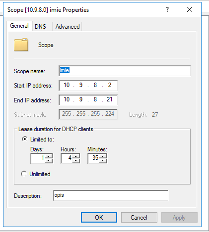

1. Dodaj adres DNS tak, aby były 3 adresy. ( opcje zakresu)

   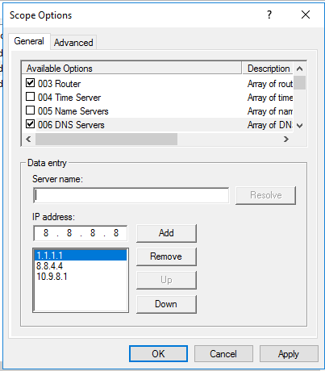

1. Sprawdź czy na stacji czy zostały pobrane nowe ustawienia. . Jeśli
    nie to wyłącz kartę, a następnie włącz ponownie.

   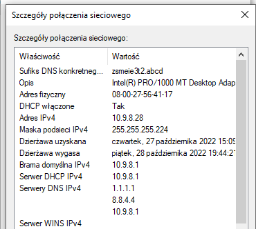

1. Usuń zastrzeżenie.

1. Wprowadź wykluczenie dla 1 adresu ip oraz dla zakresu złożonego z 3
    adresów.

   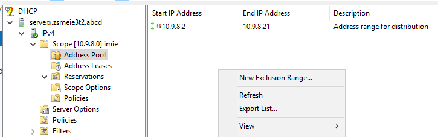

   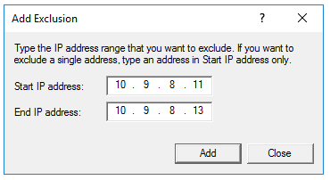

   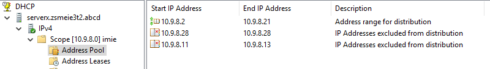

1. Na serwerze ustaw czas dzierżawy na 3 dzień 3 godziny i 33 minut.

1. Zmień kolejność serwerów DNS.

1. Sprawdź czy na stacji windows czy zostały pobrane nowe ustawienia.

   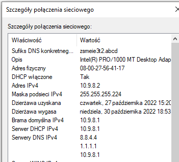

1. Sprawdź czy na stacji ubuntu czy zostały pobrane nowe ustawienia.

   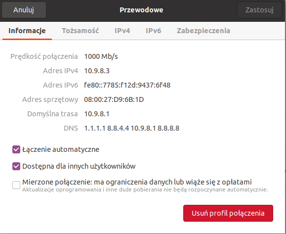

1. Komendą nmcli:

   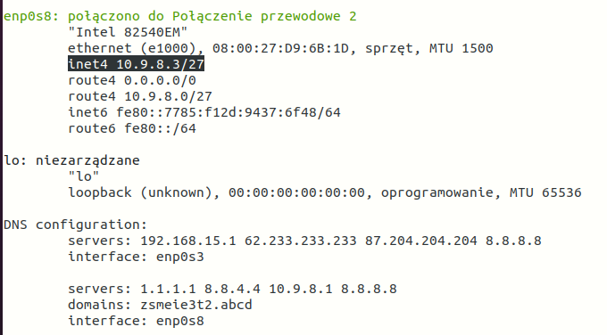

1. Wykonaj powyższe zadania dla stacji linux dla sieci, w której klient ma otrzymać adres:

   `192.168.112.212/28`.

1. Sprawdź bramkę i czas dzierżawy:

   ```bash
   ip -c r 
   ```

   , sprawdzenie bramki

   ```bash
   sudo nmcli -f dhcp4 device show 
   ```

   poszukaj frazy: `dhcp_lease_time` wartość wyrażona w sekundach

1. Wykonaj powyższe zadania dla stacji linux dla sieci, w której klient ma otrzymać adres:

   `10.40.80.151/26`

1. Wykonaj zadanie wskazane przez nauczyciela. Uzyskaj konkretny adres
    ip bez rezerwacji.

1. Wykonaj ćwiczenia dla komputera o podanym ip i masce:
    - 203.0.113.237/28
    - 192.0.2.85/29
    - 10.11.12.172/26
    - 192.168.0.235/28
    - 172.19.17.88/27
    - 10.40.80.114/29
    - 192.168.11.46/30
    - 172.20.30.126/25

1. Usuń zakres.

1. Nie usuwaj roli DHCP server.

1. KONIEC.🔚
