# Ćwiczenia 29 -- konfiguracja usługi DNS

1. Zaloguj się na swoje konto administrator.

1. Sprawdź czy dolna i górna karta sieciowa ma następującą
    konfigurację:
    - ip: 10.9.8.1/26
      - brak bramki,
      - 1 DNS 10.9.8.1
    - ip górnej karty: 172.18.19.2/28
      - bramka: 172.18.19.1,
      - 1 DNS 8.8.8.8
1. Sprawdź ustawienia kart sieciowych w wierszu poleceń:

   ```bash
   ipconfig /all
   route print.
   ```

1. Sprawdź czy jest zainstalowana rola AD i poprawnie skonfigurowana.

1. Sprawdź w Menedżerze Serwera czy jest zainstalowana rola DNS. Jeśli
    tak to przejdź do następnego punktu.

1. W strefie przeszukiwania do przodu dodaj następujące rekordy:
    - hosta ipv4 dla stacji o nazwie pc1
    - alias dla swojego serwera o nazwie ftp
    - poczty o priorytecie 5 i nazwie poczta
    - poczty o priorytecie 12 i nazwie mail
    - hosta ipv6 dla stacji o nazwie pc1
    - srv
      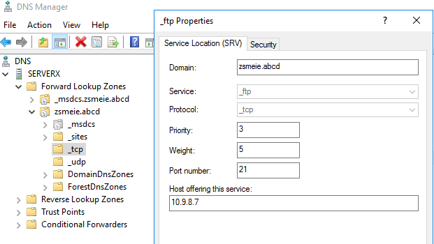
    - txt
    - inny przez Ciebie wybrany, np. HINFO

      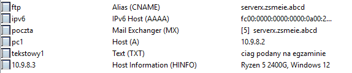

1. Przetestuj działanie DNS dla dodanych rekordów narzędziem nslookup
    na serwerze i stacji roboczej.

   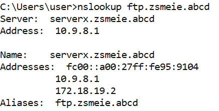

1. Przetestuj działanie dla dodanych rekordów narzędziami:

   ```bash
   nslookup 
   host
   dig
   ```

   na stacji roboczej **ubuntu**.

   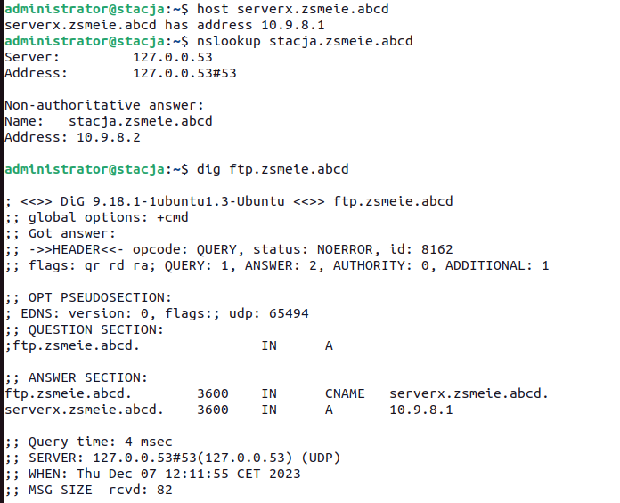

1. Dodaj strefę przeszukiwania wstecz.

   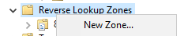

   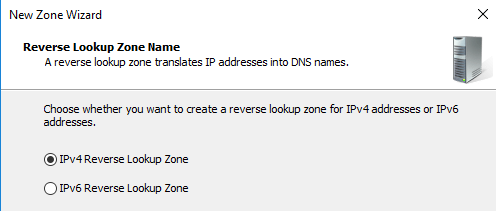

   Kolejny krok:

   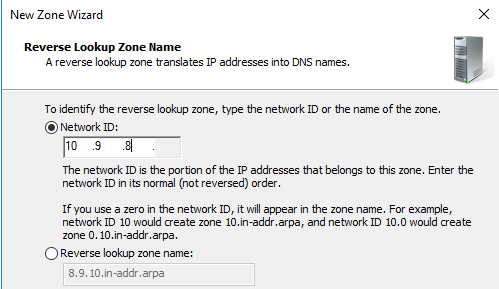

1. W strefie przeszukiwania wstecz dodaj następujące rekordy:
   - wskaźnika dla stacji pc1
   - wskaźnika dla twojego serwera
   - alias dla stacji o nazwie twoje_imie
   - alias dla serwera
   - srv
   - txt
   - inny przez Ciebie wybrany

1. Przetestuj działanie DNS dla dodanych rekordów narzędziem nslookup
    na serwerze i stacji roboczej.

   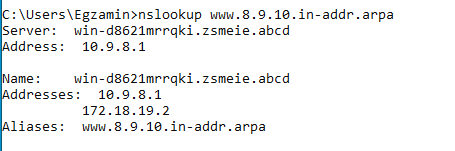

   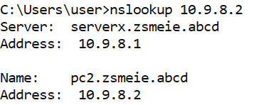

1. Przetestuj działanie dla dodanych rekordów narzędziami:

   ```bash
   nslookup 
   host
   dig
   ```

   na stacji roboczej **ubuntu**.

   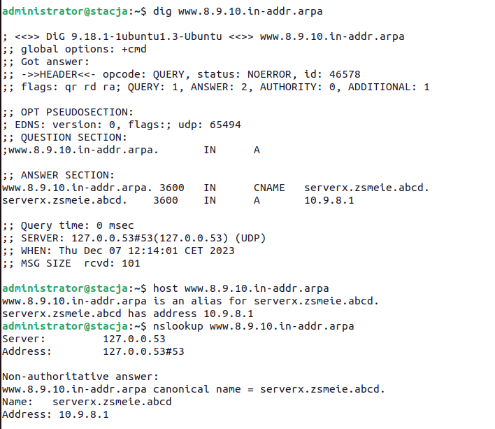

1. Dodaj odpowiednie rekordy tak, aby w przeglądarce działała strona

   [**www.zsmeie.abcd**](http://www.zsmeie.abcd/)

   

   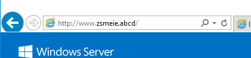

1. Usuń strefę przeszukiwania **wstecznego.**

1. Usuń dodane przez Ciebie rekordy w strefie przeszukiwania do przodu.

1. Druga osoba wykonuje powyższe ćwiczenia.

1. Koniec. 🔚

---

Zadania egzaminacyjne dla DNS:
