# Ćwiczenia 32 -- Quota dyskowa

1. Zaloguj się na swoje konto administrator.

1. Uruchom menedżer serwera i dodaj role. Dodaj pozycję dla: menadżer
    zasobów serwera plików.

   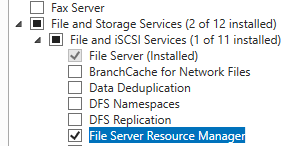

1. Po instalacji uruchomić przystawkę: Narzędzia administracyjne →
    *Menadżer zasobów serwera plików(Tools-\>File Server Resource
    Manager)*

   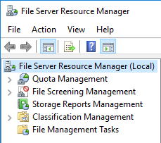

1. Utworzyć nowe konto o nazwie **twoje_imię_quota** dla którego należy
   ustawić folder macierzysty (ścieżka UNC) na udostępniony, ukryty zasób sieciowy
   [c:\\przydziały_dyskowe](../../../../../E:/c:/przydziały_dyskowe) oraz
   zamapować pod literę dysku Q.

   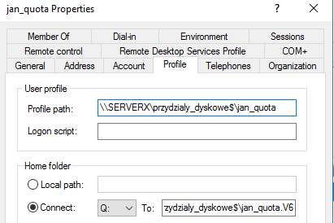

1. Zalogować się na konto **twoje_imię_quota** i sprawdzić poprawność
    zamapowania dysku.

   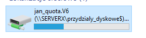

1. Utwórz drugie konto tak jak w punktach poprzednich.

1. Najpierw utwórz swój szablon np. 3k

   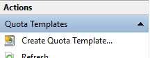

1. W przystawcę *Menadżer zasobów serwera plików,* z lewej strony
    wybrać:

   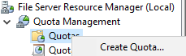

   Zarządzanie przydziałami→ Przydziały.

   Następnie wybrać akcję:

   Utwórz przydział.

1. Ścieżkę przydziału ustaw na katalog użytkownika z profilami czyli

   [c:\\przydziały_dyskowe](../../../../../E:/c:/przydziały_dyskowe)\\.

   Najpierw utwórz swój szablon np. 3k

   Zaznacz: Automatycznie zastosuj szablon i utwórz przydziały dla
   istniejących i nowych podfolderów.

   Ustaw:

   - limit na 25MB
   - limit sztywny (hard)
   - próg ostrzeżeń na 35%
   - wyślij ostrzeżenie do dziennika zdarzeń
   - generuj raporty: duże pliki, pliki według właściciela, użycie
     przydziału
   - wyślij raport do użytkownika, który przekroczył próg

     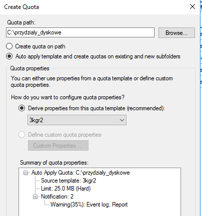

1. Odśwież widok przydziałów w przystawce na serwerze.

   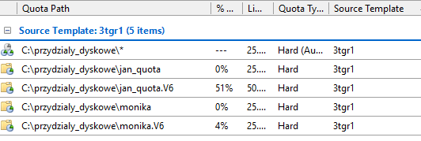

1. Będąc zalogowanym na koncie twoje_imię_quota

   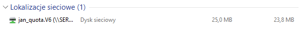

   spowoduj pojawienie się komunikatu o ostrzeżeniu.

   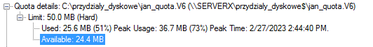

1. Sprawdź dzienniki zdarzeń.

   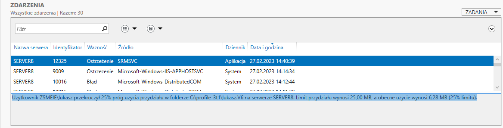

1. Będąc zalogowanym na koncie twoje_imię_quota spowoduj pojawienie się
    komunikatu o przekroczeniu limitu przydziału dysku.

1. Sprawdź dzienniki zdarzeń oraz raporty.

   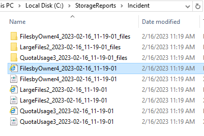

1. Sprawdź czy utworzyły się raporty
    %systemdrive%\\StorageReports\\Incident. Przejrzyj je.

   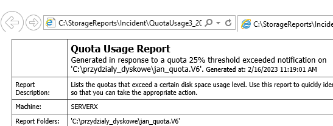

1. Dla pierwszego konta zmień przydział na 50MB, a drugiego próg
    ostrzeżeń na 60%.

   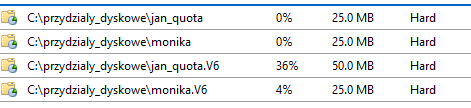

1. Powtórz poprzednie punkty, ale dla **przydziału elastycznego**,
    zmień próg ostrzeżeń na 75%.

1. Napisz skrypt, który wyświetli aktualne przydziały w systemie.

1. Napisz skrypt i sprawdź jego działanie, który ustawi limit na 100MB
    dla wybranego konta.
1. Na klonie stacji windows w virtualbox wykonaj przydziały dyskowe lokalnie.

   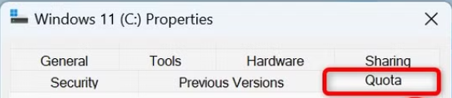

1. Koniec. 🔚
